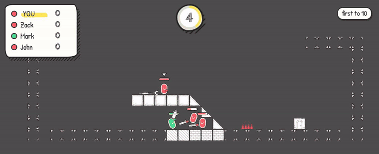
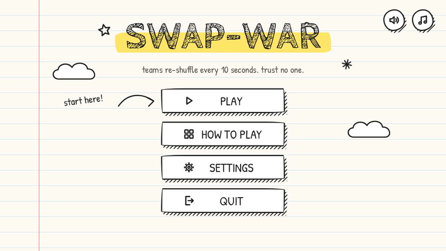
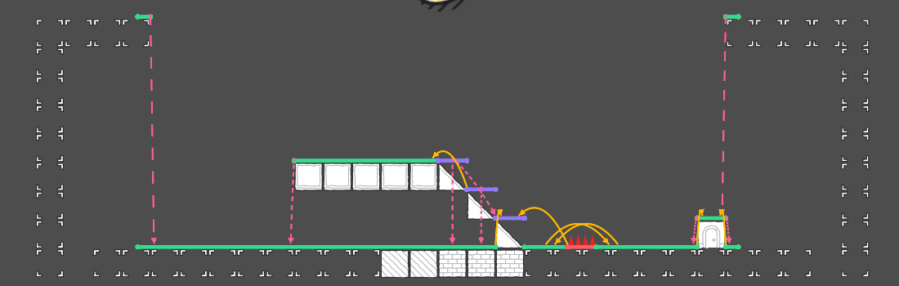
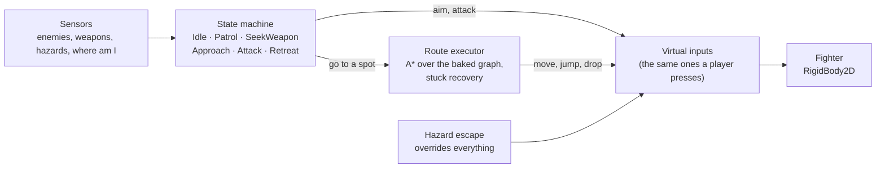

# Swap-War

A 2D physics brawler where the teams re-shuffle every 10 seconds, so the bot fighting beside you can be chasing you a moment later. You play against up to three AI fighters that find their way around the arena, pick up weapons, jump over spikes and run away when they're hurt. Made in Godot 4.7 with GDScript; it started as a Brackeys Game Jam entry and grew into a full game for the web and Android.

**[Play it in your browser](https://bakirsobashy.github.io/swap-war/)** · keyboard and mouse, or touch on a phone

[](https://github.com/bakirsobashy/swap-war/actions/workflows/ci.yml)
[](https://github.com/bakirsobashy/swap-war/actions/workflows/deploy-web.yml)



_The timer turns into the colour you're about to become two seconds before the swap, so you get a moment to back off from your next enemy._

## How it plays

- **Teams swap every 10 seconds.** Same colour means ally, different colour means enemy. Kills only count against enemies, so the swap can turn a winning fight into a losing one.
- **Weapons drop from the sky.** Three melee weapons (sword, spear, fork) and two guns (pistol, rifle), each with its own damage, knockback and durability. Fighters spawn unarmed and pick weapons up by walking over them.
- **Matches:** 1 to 3 bots, first to a score or most kills before the clock runs out, on three arenas, one of them with a spike strip.
- **Controls:** A/D to move, Space or W to jump, S to drop through a ledge, left mouse button to attack, E to drop your weapon, Esc to pause. On a phone: two sticks (move and aim) and buttons you can move and resize in Settings, plus an optional auto-attack.



## Highlights

- **AI that reads the level.** When an arena loads, the AI turns its tiles into a graph: every flat run of floor becomes a platform, and the moves between them become edges (walk, jump up, jump across, drop down). The jump limits come from measured jump physics, not guesses. Spikes split a platform and make walking it expensive, so A\* plans a jump over them instead. Nobody places waypoints by hand: a new arena gets its graph automatically, and a few marker nodes fix the spots the bake gets wrong.

  

  _The graph for the spike arena. Green: solid floor. Purple: one-way slopes. Red: the spike strip. Yellow: jumps. Pink: drops._

- **A state machine for decisions.** Six states (idle, patrol, seek weapon, approach, attack, retreat) decide what each bot wants, and a route executor carries it out edge by edge, with a fallback ladder when a bot gets stuck: micro-jump, replan, then mark the failed edge as blocked for a few seconds. Guns only fire when two parallel rays reach the target and the barrel has actually turned toward it. Moves that bypass the route are checked first, so a bot never runs off a deadly ledge or into spikes.
- **Physics-driven fighters.** Each fighter is a `RigidBody2D` moved with forces and impulses, never by setting its velocity, so hits knock bodies around naturally. Held weapons deal damage when they touch an enemy, and knockback comes from the weapon's speed at impact.
- **Tested headless.** 15 probe scripts run the real game without a window: they bake every arena's graph, plan routes, play out live AI fights, check hazard damage and melee swing hits, the touch sticks, the HUD layout at three screen sizes, the menus, and replay the bugs reproduced in an October 2026 audit, so a fixed one can't come back. They run on every push and pull request on GitHub Actions.
- **Shipped to the web on every push.** A second workflow exports the web build with Godot's export templates and deploys it to GitHub Pages. An Android export preset builds the same game for phones.

## How it's built



The AI drives its fighter through the same inputs as a human player, so bots and players share one movement and combat code path. During the swap, a bot holds its current state for a short reaction time instead of resetting, then picks up a new target once its sensors catch up.

| Part | Where |
| --- | --- |
| Match flow, teams, score, settings (autoloads) | `Scripts/Components/` (`ArenaManager`, `TeamManager`, `ScoreManager`, `SettingsManager`) |
| Navigation graph, baker, A\*, route executor | `Scripts/AI/` |
| AI states | `Scripts/AI/States/` |
| Movement | `Scripts/Actor-Movement.gd` |
| Weapons and their stats | `Scripts/Weapons/` |
| Menus, HUD, touch controls, layout editor | `Scripts/UI/`, `Scenes/UI/` |
| Headless probes and tools | `Tools/` |

The reasons behind the main choices are in [docs/decisions.md](docs/decisions.md). The original jam design and the full-game roadmap are in [docs/godot-prompter/plans/](docs/godot-prompter/plans/).

## Run it locally

You need [Godot 4.7](https://godotengine.org/download/) (the standard build, not .NET).

```sh
godot -e --path .          # open in the editor
godot --path .             # play from the main menu
godot --path . Scenes/Arenas/ArenaHazards.tscn   # jump straight into a match
```

### Tests

```sh
godot --headless --path . --import    # first time only
Tools/run_probes.sh                   # Linux / macOS (set GODOT=/path/to/godot if it isn't on PATH)
pwsh Tools/run_probes.ps1             # Windows
```

A probe passes when it exits with 0 and prints no `SCRIPT ERROR`. To run one: `godot --headless --path . -s Tools/nav_astar_probe.gd`.

To redraw the navigation graph picture above (needs a display): `godot --path . -s Tools/nav_graph_snapshot.gd -- res://Scenes/Arenas/ArenaHazards.tscn nav-graph.png`.

### Builds

The `Web` and `Android` presets are in `export_presets.cfg`. Exports go to `build/`, which Git ignores.

```sh
godot --headless --path . --export-release "Web" build/web/index.html
```

## Credits

- Platformer art: [Scribble Platformer](https://kenney.nl/assets/scribble-platformer) by [Kenney](https://kenney.nl) (CC0).
- Fonts: Patrick Hand and Cabin Sketch, under the SIL Open Font License (license files are next to the fonts in `Assets/ui/ui-2.0/scribble_ui/fonts/`).

## License

The code is under the [MIT License](LICENSE). The art, fonts and audio keep their own licenses, listed above.
